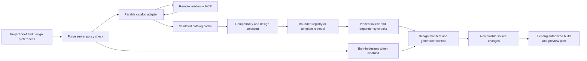

# Parable as Forge’s default design source

Research date: September 11, 2026. Status: researched proposal; integration is not implemented by this document.

## Product decision

Make Parable the built-in, enabled-by-default design catalog for **new Forge projects**, with account-level and project-level opt-out. Make its entire catalog discoverable. Import only the components or template sections a project actually needs. Keep Parable as the user’s separate project, with its own repository, deployment, identity and release cycle.

Use Parable to improve both generated websites and selected Forge interactions. Forge retains its neutral workspace, IBM Plex Mono typography, paired themes and existing architecture. Generated projects may use much more expressive typography, imagery, color and motion inside isolated previews.

“Default MCP” means Forge’s server knows how to query Parable without users pasting a URL or entering a key. It does not mean configuring every user’s desktop assistant, installing all components, or turning Parable into a generation/deployment service. No global Codex configuration changes are part of this plan.

## Verified research

The inspected [repository](https://github.com/shellcat-com/parable/tree/05aa28a43a703584aca75e20e3293b1651a72019) is pinned at `05aa28a43a703584aca75e20e3293b1651a72019`. Live endpoint results were captured separately; a working deployment is not proof that it runs that exact commit. Full inventories and protocol evidence are in [the research folder](../../research/parable/2026-09-11/README.md).

| Surface | Observed result | Meaning for Forge |
| --- | --- | --- |
| Components | 88 entries: 33 interactive, 24 blocks, 14 effects, 9 text, 6 hero backgrounds, 2 loaders | All can be cataloged; inclusion in output needs compatibility checks |
| Templates | 78: 51 Parable and 27 Formwork | Preserve both families under the Parable source |
| Template stacks | 52 static, 11 Astro, 6 Next.js, 5 Vite, 4 Svelte | Catalog availability must remain separate from supported generation stacks |
| Remote MCP | `https://parable-three.vercel.app/api/mcp`; unauthenticated JSON-RPC POST | Built-in server adapter needs no user key |
| Initialization | Server `parable` version `0.1.0`, protocol `2025-06-18` | Negotiate/test this version; do not assume latest-protocol compliance |
| Discovery | `list_components`, `get_component`, `list_templates`, `get_template` | Four read-only catalog tools; no build/install/deploy tool |
| Component detail | Metadata, dependencies, props, registry URL and install command | Fetch registry JSON separately for actual source |
| Template detail | Metadata, repository, live URL, thumbnail and clone command | Resolve the separate template repository at a pinned commit |
| Registry | Three sample files returned source and install targets successfully | Enough to prove retrieval; not a full installation/build audit |

These counts are from the [catalog source](https://github.com/shellcat-com/parable/blob/05aa28a43a703584aca75e20e3293b1651a72019/registry.json) and live MCP responses, not estimates. Some introduction copy says five categories; the actual registry and filtering UI contain six component categories.

### Findings that affect implementation

1. **React integration is not automatic.** Components are TSX and commonly use Motion and Tailwind utilities. Forge’s shell renders escaped markup using TypeScript. Its standalone HTML generator forbids remote scripts and network requests. Neither can directly render arbitrary registry TSX.
2. **Dependencies need repair before release.** A static import scan found 13 items using `lucide-react` without declaring it in the registry: `dynamic-island`, `expandable-card`, `device-frame`, `sign-in-slice`, `shift-card`, `notification-stack`, `token-swap-card`, `hover-member-row`, `intro-disclosure`, `tweet-grid`, `ai-input`, `command-palette`, `faq-accordion`. Three live registry probes confirmed the corresponding metadata for AI Input, Command Palette and Device Frame. This is a metadata audit, not proof that every other component builds.
3. **MCP needs a compatibility adapter.** Missing components return an embedded `{error: ...}` in a successful text result without `isError`. An initialized notification returns HTTP 200 with JSON `null`. Source inspection shows a fixed protocol response, limited input validation and OPTIONS allowing only `Content-Type`. Implement a narrow tested client and improve Parable’s protocol behavior separately. Do not call the endpoint directly from the browser or assume compatibility with every MCP SDK. [Route source](https://github.com/shellcat-com/parable/blob/05aa28a43a703584aca75e20e3293b1651a72019/app/api/mcp/route.ts), [transport specification](https://modelcontextprotocol.io/specification/2025-11-25/basic/transports).
4. **Theming needs a component audit.** The docs describe semantic theming, but inspected source also contains explicit dark surfaces and white text. Build light/dark examples for each promoted component; map or expose these colors before claiming inheritance works universally. [Theming documentation](https://parable-three.vercel.app/docs/theming), [AI Input source](https://github.com/shellcat-com/parable/blob/05aa28a43a703584aca75e20e3293b1651a72019/registry/parable/ui/ai-input.tsx).
5. **Visual success is not service success.** `sign-in-slice` defaults to a roughly 1.2-second fake submit before showing success. Connect an actual handler, propagate rejection, and show only supported sign-in methods. Financial blocks, testimonials, metrics and other sample content likewise require real data or explicit demo labels. [Sign-in source](https://github.com/shellcat-com/parable/blob/05aa28a43a703584aca75e20e3293b1651a72019/registry/parable/ui/sign-in-slice.tsx).
6. **Templates are design showcases.** The inspected Fieldnote deployment explicitly labels itself a design-showcase concept, not a shipping product. Its working palette is useful interaction evidence; its customer/latency figures and product claims are not Forge evidence. [Fieldnote live reference](https://shellcat-com.github.io/fieldnote-research/).

Parable’s repository contains an MIT license and documents its inspiration metadata. Preserve the license notice in redistributed source, retain source attribution/provenance, and inspect each separate template repository and its image/font dependencies before admitting it to generation. Do not assume an inspiration credit grants rights to another library’s code. [License](https://github.com/shellcat-com/parable/blob/05aa28a43a703584aca75e20e3293b1651a72019/LICENSE), [attribution policy](https://parable-three.vercel.app/docs/attribution).

## Design direction for Forge itself

Recommended direction: **a quiet design studio with prominent project previews**. Parable’s gallery is the strongest reference: clear navigation, search, concise filters, large previews and useful metadata. Its homepage shader belongs in the inspiration library; Forge’s working canvas should remain readable and calm.

| Forge surface | Proposed improvement | Parable reference | Implementation decision |
| --- | --- | --- | --- |
| Landing | Lead with a large honest product demo and curated design examples | `device-frame`, `hero-section`, `feature-bento`, `faq-accordion` | Adapt composition to existing markup and tokens; retain original artwork |
| Brief composer | Comfortable expanding input, suggestions, visible submit/cancel state | `ai-input` | Native textarea; preserve drafts on failure; show actual supported providers |
| Direction step | Presets plus a searchable template/component gallery | Catalog search and filter layout | Add source and compatibility filters; keep selected content on switching |
| Workspace | Consistent plan/source/preview navigation, clear activity history | `morph-tabs`, `activity-feed`, `stepper` | Bind to real state; use current 160ms opacity/color rules |
| Search | Keyboard command menu for projects, designs and navigation | `command-palette` | Implement using Forge’s shared component architecture and accessible dialog behavior |
| Preview | Desktop/tablet/mobile frame controls; separate theme and motion controls | `device-frame`, `theme-toggle` | Keep preview CSS and theme scoped |
| Onboarding | Short, skippable contextual introduction with replay | `intro-disclosure` | Enhance current guided flow; never reset projects |
| State feedback | Legible loading placeholders and progress | `skeleton`, `progress-ring` | Indeterminate progress when duration is unknown; no invented percentages |
| Mobile detail | Accessible selection sheet with clear Close/Apply actions | `family-drawer` | Native modal behavior with focus return; no drag-only controls |

Reuse structural and interaction ideas in the current shell. Directly copying React components into `src/components` would require a new rendering island or migration and is not recommended for this phase. Production application primitives should prefer existing tested shared components and native controls.

### Layout specification

- Keep the 220px desktop navigation. In Design Library, use a compact title/source row, search, filters and a preview grid. At 1440px target three cards where the remaining content width allows; at 768px use two; at 390px use one. Mobile filters open a labeled sheet and show the active filter count.
- Each card contains a fixed-aspect thumbnail, title, concise purpose, source, stack, motion level and availability. Separate “Preview” from “Use design.” Never label metadata-only entries “Ready to generate.”
- Detail view offers Preview, Components and Source information. Show dependencies and licensing in details, not the primary creation flow. Include a plain explanation when an item needs adaptation.
- Start galleries with static thumbnails; load one live component or template preview when requested. Avoid running 88 animations at once.
- Keep project name and prompt stable when changing direction. Show a before/after preview and an explicit Apply action for changes to an existing project.
- Keep brand tokens from `DESIGN.md`; do not introduce Parable’s purple logo or site identity into Forge chrome. Update the specification and bundled references when implementation intentionally changes the design system.

## Design options for generated websites

These are proposed Forge compositions, not new preset IDs already present in code. Retain the five existing preset IDs and version history. Start by adding recipes and curated references to them; add new versioned IDs only when a distinct reusable system is implemented.

| Direction | Existing preset base | Composition and typography | Parable references | Motion |
| --- | --- | --- | --- | --- |
| Technical Studio — recommended general default | Technical Mono | Ruled sections, dense useful controls, clear monospace hierarchy; product UI as the main visual | Fieldnote, Formwork Velocity; `command-palette`, `ai-input`, `feature-bento` | Minimal |
| Editorial Product | Editorial Product | Broad whitespace, asymmetric editorial grid, large product imagery; readable Inter body | Formwork Grid, Formwork Atelier; `hero-section`, `image-reveal`, `compare-slider` | Subtle once-on-view |
| Cinematic Portfolio | Cinematic Monochrome | Instrument Serif display accents, restrained dark/light imagery, large case studies | Vantage Point, Formwork Award; `parallax-hero`, `drag-scroll-gallery` | Optional parallax; static mobile alternative |
| Atmospheric Digital | Atmospheric Pixel | Short pixel titles, sans body, muted rose/lavender environment; one visual centerpiece | Overclock, Formwork Phosphor; `pixel-canvas`, `text-scramble` | Expressive opt-in |
| Natural Craft | Illustrated Landscape | Warm neutral surfaces, scenic or material photography, spacious product stories | Kiln Collective, Bramble, Conche; `image-reveal`, `faq-accordion` | Subtle |
| Data Workspace | Technical Mono initially | High-density but readable tables, contextual charts, utility navigation, tabular numerals | Meridian Advisor, Redoubt; `stat-card`, `bar-chart`, `donut-chart`, `activity-feed` | Functional only |
| Luminous Launch | Editorial Product initially | Large sans headline, dark product frame, restrained cyan/violet atmosphere confined to hero | Formwork Aether; `dither-aurora`, `feature-bento`, `cta-banner` | One optional shader |

Technical Mono remains the default **style** while Parable becomes the default **source**. These are independent preferences. The entire catalog remains available for a user choosing a different direction.

Choose one coherent system per project: typography scale, light/dark palette, radius, grid, icon treatment and motion vocabulary. The model should adapt components to that system rather than combining unrelated catalog defaults. Strong hierarchy and meaningful content matter more than adding effects.

For long-lived motion, provide Pause/Reduce motion controls and static fallbacks. Prefer a maximum of one prominent continuous effect in view, stop offscreen work, and disable autoplay/audio by default. These are proposed Forge performance rules, not measured Parable guarantees. [Motion reduced-motion guidance](https://motion.dev/docs/react-use-reduced-motion).

## Default and opt-out behavior

Account setting: **Design sources → Parable → Use for new projects**, enabled by default for new accounts once available. Local mode stores an equivalent validated browser preference. Self-host administrators can disable all remote design sources.

Project setting: **Design source: Use account setting / Parable / Built-in only**. Resolve the inherited value when creating the project and store the effective selection with its design revision, so a later default change does not silently restyle an existing project.

| Situation | Required behavior |
| --- | --- |
| New account and new project | Parable selected; a short visible explanation links to source settings |
| Existing project after migration | Preserve its current preset and source; no silent catalog imports |
| Account default switched off | Future projects use built-in designs; explicit existing-project choices remain visible |
| Project switched to built-in only | Stop future Parable requests and remove Parable from generation candidate selection |
| Source disabled while a request is running | Abort it where possible; discard late results before they can be applied |
| Previously imported source | Keep it editable and exportable; disabling a source never deletes project files |
| Remove previously imported components | Separate reviewable edit with dependency/reference checks |
| Administrator disables remote sources | Override project enablement; no upstream calls or automatic stale-source generation |
| Endpoint unavailable | Preserve work; offer Retry or Continue with built-in designs; show cached previews as cached |
| User re-enables Parable | Refresh catalog on demand; retain existing file edits and pinned versions |

“Built-in only” excludes new Parable retrieval and selection. If Parable-derived code is already present, edits may retain it; explain that disabling future use does not rewrite history. Offer a separate replacement workflow if the user wants it removed entirely.

Proposed copy:

> Parable helps Forge choose components and website designs. It is on for new projects. You can turn it off at any time. Code already added to a project stays yours.

Show Connected only after a successful check, alongside checked-at time. Distinguish Configured, Checking, Available, Cached, Unavailable and Disabled. A saved boolean is not connection evidence.

## Technical architecture



### A. Catalog adapter

Add a narrow `ParableCatalog` interface with list/get methods. Forge performs deterministic discovery and fetches selected references before invoking the model. This works with providers that cannot call MCP tools. Model-native tool calling can follow later; it is not a prerequisite.

Server configuration pins a provider ID, endpoint and registry base. Example desired configuration, not a configuration file Forge currently understands:

```json
{
  "id": "parable",
  "enabledByDefault": true,
  "endpoint": "https://parable-three.vercel.app/api/mcp",
  "registryBase": "https://parable-three.vercel.app/r/",
  "transport": "streamable-http",
  "tools": ["list_components", "get_component", "list_templates", "get_template"]
}
```

Use HTTPS, fixed allowed hosts and validated slugs. Treat remote strings as data: never execute returned install/clone commands, promote them to system instructions, or accept arbitrary local file destinations. Send only category, stack, family and slug filters to the public catalog; never send private briefs, source, provider credentials or account identifiers. Fetch registry content only after validating the resolved URL and redirect policy.

Proposed initial limits: 8-second request timeout, one retry with jitter for transient read failures, 15-minute metadata cache, 24-hour stale browsing fallback with visible age, 2 MiB maximum detail/registry response and 10 source components per initial generation. Tune from actual measurements. Separate tenant preferences from public catalog caching. No per-tenant background refresh when that tenant has disabled the source.

Check HTTP status, JSON-RPC version/ID, top-level errors, MCP `isError`, content-block type and the decoded embedded result. Validate list/detail schemas and classify embedded `{error}` results as failures. Support JSON responses and correctly parse SSE if a supported transport uses it. Record negotiated version rather than forcing an unsupported version through silently.

Upstream Parable maintenance can independently add schema validation, standard error shapes, notification status handling, transport conformance tests, ETags/version metadata, declared dependency fixes and a health endpoint. Until then, keep observed quirks isolated to the adapter. No edits to the separate Parable repository were made in this research pass.

### B. Compatibility and source delivery

| Forge target | Initial use of Parable | Import/build status |
| --- | --- | --- |
| Current Vite/TypeScript shell | Adapt reviewed layouts and interactions to shared native components | No direct TSX import |
| Text-planning mode | Supply selected metadata and a bounded design specification | Planning only |
| Standalone generated HTML | Use design recipes and separately reviewed HTML/CSS equivalents | Raw TSX and remote dependencies unavailable; preserve current sandbox/CSP |
| Next.js + PostgreSQL engine path | Admit compatible React source into a versioned generated template | Requires approved dependency set, source review and working existing runtime |
| Astro, Svelte, static and Vite template catalog | Browse all; allow inspiration selection with explicit adaptation status | Do not advertise all stacks as executable support |

The current Next.js candidate template does not include Tailwind, Motion or Lucide. Add and lock needed versions in a **new template release**, validate React/client boundaries and CSS build setup, then recalculate catalog/template digests. The generator must not alter protected package files or bypass the existing offline dependency policy. This work depends on the runtime’s real readiness; catalog integration alone cannot close it.

For eligible React exports, include the shadcn registry namespace in the generated project’s `components.json`:

```json
{ "registries": { "@parable": "https://parable-three.vercel.app/r/{name}.json" } }
```

This is a registry configuration fragment, not a complete `components.json` and not an MCP connection. Forge should materialize reviewed, pinned registry bytes through its source pipeline. Interactive users can optionally use shadcn’s own CLI/MCP workflow in exported projects. [Registry docs](https://ui.shadcn.com/docs/registry), [shadcn MCP docs](https://ui.shadcn.com/docs/mcp).

Map registry targets into allowed generated roots; reject path traversal, duplicates, forbidden extensions and overwrites of protected files. Resolve dependency closure, require explicit supported packages and pinned versions, check `use client`, local aliases, external assets, CSS injection and side effects. Do not run installation scripts in the Forge control process.

Treat template selection in two ways: “Use this direction” extracts a reviewed design recipe into the supported Forge stack; “Start from this template” is enabled only when that template’s exact stack and build have passed admission. Whole-template clones do not automatically become functioning backends.

### C. Design manifest and generation context

Persist a versioned design manifest containing source preference, effective source, preset ID/version, motion preference, target stack, catalog retrieval time, component/template IDs, exact source hashes, upstream repository commits where known, dependencies, licenses, adaptation status and token overrides. Keep upstream originals distinguishable from generated adaptations.

Build a bounded selection process:

1. Derive site purpose, audience, required interactions and content hierarchy from the brief.
2. Apply source preferences and target-stack constraints before searching.
3. Shortlist at most three coherent directions, with a concise reason for each.
4. Respect explicit user selections; fetch only selected details/source and dependency closure.
5. Define actual sections and page flows, then bind components to data and event handlers.
6. Supply the model with a design contract and selected source as untrusted reference material.
7. Return source changes through the existing review workflow; validate build, behavior, accessibility and visuals before marking usable.

Do not inject the entire 166-entry catalog or all component source into every prompt. Search metadata locally after the catalog fetch and bound model context. Include a design-manifest digest in the engine’s plan/source binding so a catalog update cannot change an already reviewed result.

### D. Persistence and file map

| Area | Existing files / proposed addition | Work |
| --- | --- | --- |
| Defaults and local persistence | `src/storage.ts`, `src/project.ts`; proposed `src/design/sources.ts` | Versioned preference and migration; preserve old projects |
| Account settings and onboarding | `src/cloud/main.ts`, `src/cloud/client.ts`, `server/cloud/contracts.mjs`, `server/cloud/store.mjs`, `server/cloud/schema.mjs` | Tenant-scoped settings, project override, revision checks and migration |
| Catalog UI | `src/pages/designs.ts`, `src/pages/workspace.ts`, `src/main.ts`, `src/components/` | Search, filter, details, selection and source state |
| Design data | `src/design/presets.ts`, `src/design/tokens.css` | Reusable recipes, scoped token adapters and versions |
| Export | `src/export.ts` | Manifest, source provenance, dependency notices and registry configuration where compatible |
| Loopback and cloud planning | `server/app.mjs`, `server/provider.mjs`, `server/cloud/planning.mjs` | Shared adapter contract, bounded design context and capability response |
| MCP implementation | Proposed `server/design/parable.mjs` and shared schemas | Fetching, validation, caching, availability and disabled-state enforcement |
| Engine | `engine/generation/context.ts`, `engine/generation/catalog.ts`, `engine/contracts/source.ts` | Manifest binding, admitted source and versioned dependency catalog |
| Generated template | Versioned successor to `templates/next-postgres-v1/` | Reviewed React styling/dependency support; existing protected file rules |
| Specification | `DESIGN.md` and repository design-skill references | Document intentional UI changes at implementation time |

Do not use Parable as an AI provider in `src/cloud/providers.ts`: it supplies design material, not model inference or billing credentials. The repository has substantial existing uncommitted work; implementations must preserve it and coordinate against the current contracts rather than older roadmap descriptions.

## Other component sources and design references

Parable stays first and default. Additional sources are explicit opt-in options; they do not silently replace a failed Parable request.

| Source | Best role | Proposed relationship |
| --- | --- | --- |
| [shadcn/ui](https://ui.shadcn.com/docs/registry) | Source-owned app primitives and registry interoperability | Baseline primitives in compatible generated React templates |
| [Radix Primitives](https://www.radix-ui.com/primitives/docs/overview/accessibility) | Focus, keyboard and ARIA behavior for complex controls | Behavioral reference or chosen primitive foundation |
| [Base UI](https://base-ui.com/react/overview/quick-start) | Alternative unstyled React primitive foundation | Choose deliberately per generated template; avoid duplicating two foundations |
| [Motion](https://motion.dev/docs/react-use-reduced-motion) | Animation mechanics and adaptive reduced motion | Pin as a dependency where chosen Parable components need it |
| [Magic UI](https://magicui.design/docs) | Additional marketing effects and presentation components | Optional curated source after per-item review; premium offerings remain separate |
| [React Bits](https://reactbits.dev/get-started/introduction) | Additional expressive visual references | Reference candidate; page text was not retrievable in this pass, so no source/license/import recommendation is made |

“Best” means appropriate to the project: readable hierarchy, complete mobile behavior, useful interactions, credible content, consistent tokens and acceptable loading cost. It is not a universal ranking by number of animations. Parable covers much of the expressive layer already; adding more catalogs is lower priority than reliable selection and output quality.

## Delivery sequence and acceptance

### Phase 1 — catalog and preference foundation

Implement the tested adapter, full catalog metadata, source state, local/account defaults, project override and existing-project migration. All 88 components and 78 templates from the pinned snapshot must be discoverable; counts become data-driven thereafter.

Accept when endpoint failures do not block project editing, disabling the source prevents outgoing Parable requests and late-result application, account defaults affect only new projects, and old source remains exportable. This phase can ship before executable generation support.

### Phase 2 — Design Library and Forge interaction polish

Add search/filter/detail/preview/selection flows, curated directions, before/after application and the native composer/preview improvements. Keep one live preview active and provide explicit cached/incompatible states.

Accept when all affected views work at 390/768/1440px in light/dark, keyboard focus remains visible and returns from dialogs, 200% zoom is usable, reflow is checked at 320 CSS pixels, and reduced motion removes distracting effects. Validate contrast and non-drag alternatives against [WCAG 2.2 guidance](https://www.w3.org/WAI/WCAG22/quickref/).

### Phase 3 — generation and export

Connect selected design manifests to text plans and reviewed standalone HTML recipes. Separately release the admitted React component set for the supported Next.js engine template. Start with structural/functional components; expand to heavy visual effects only after performance checks.

Accept when generated code uses verified source/adaptations, actual handlers determine success, protected file rules pass, dependencies are reproducible, exports run without calling Parable at runtime, and the chosen flow works in a real available preview environment. Label fixture-only tests as fixtures.

### Phase 4 — full compatibility coverage and maintenance

Promote remaining entries individually after source, dependency, theme, accessibility, asset and build checks. Add alternative stack adapters only with actual support. Give entries separate Discoverable, Reviewed, Adapted and Build-tested states. Track coverage by category and stack; do not confuse catalog coverage with execution support.

Maintain a pinned known-good snapshot and review upstream diffs before promotion. Never overwrite edited project copies automatically. A release switch can disable retrieval while built-in designs remain usable. Rollback restores the previous catalog/template release and defaults without deleting project source.

### Test and quality requirements

- Adapter: valid handshake, embedded errors, malformed responses, wrong IDs, timeouts, aborts, unavailable endpoints, oversized bodies, disallowed redirects and paths.
- Preferences: local and cloud migrations, project inheritance, two-account isolation, administrator override, disable during request, and persistence across reloads.
- Import: dependency omission fixtures, source hashes, protected paths, client boundaries, missing assets and duplicate targets; reproducible dependency resolution.
- Product behavior: choose a direction, preview it, apply it, request an edit, switch source off, continue editing and export; failures preserve entered work.
- Visuals: preview/shell style isolation, both themes, all required widths, keyboard, zoom and reduced motion; actual browser inspection for changed screens.
- Content: no demo authentication, financial operations, fake testimonials or sample metrics presented as real capabilities.
- Performance: use static thumbnails and on-demand previews. Target LCP ≤2.5s, INP ≤200ms and CLS ≤0.1 at the 75th percentile where field data is available; lab measurements are provisional evidence. [Core Web Vitals](https://web.dev/articles/vitals).
- Run `npm run verify` for every implementation milestone. Report unrelated baseline failures separately rather than claiming the new integration passed.

## Scope of this research pass

Completed: current repository/skill inspection, pinned Parable source inspection, full catalog inventory, all four live tool calls, initialization/error probes, three registry source retrieval checks, dependency metadata scan, and browser inspection of Parable’s homepage in both themes, its template gallery and Fieldnote’s deployed design.

Not completed or claimed: build/testing of all 166 entries, mobile/accessibility audit of the full catalog, license/asset audit of every template repository, MCP SDK conformance certification, Forge UI integration, default MCP installation, or new generation/deployment capability. Those are explicit implementation milestones above.

Research-artifact validation: every saved JSON file parsed and all relative document links resolved. `npm run verify` was attempted; it remained at `eslint .` without further output for approximately five minutes and was interrupted. No passing lint, typecheck, test or build result is claimed. This pass changes research/planning files only.
